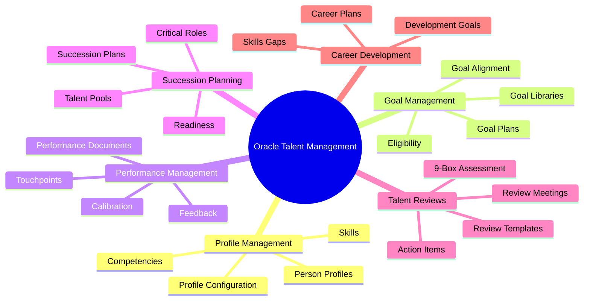
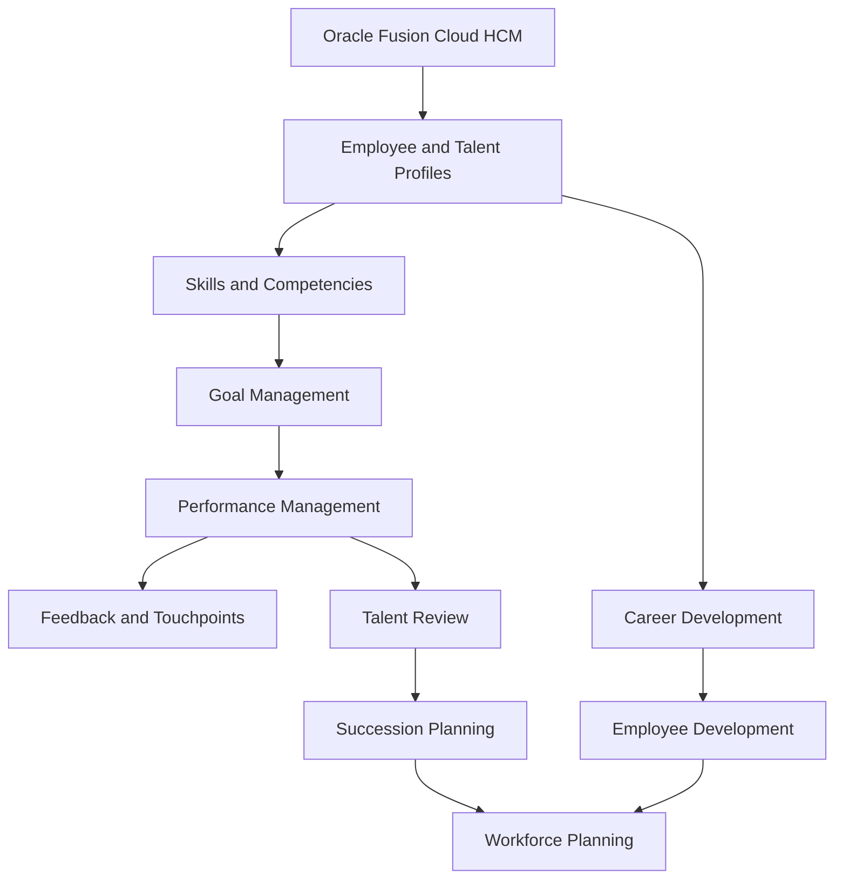
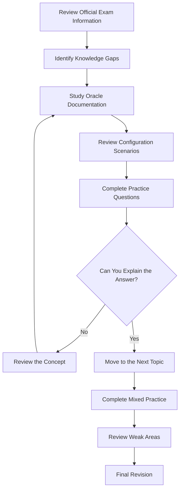
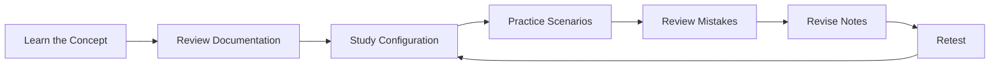

 Oracle 1Z0-1052-26: Talent Management Cloud 2026 Implementation Professional

Prepare for the Oracle Talent Management Cloud 2026 Implementation Professional (1Z0-1052-26) certification with a structured study guide covering Oracle Fusion Cloud HCM, talent management configuration, performance processes, succession planning, and practical implementation concepts.

This repository organizes key study areas, visual learning diagrams, a preparation roadmap, and useful official learning resources to support a focused exam preparation journey.

Explore exam preparation resources:[CertsGate — Oracle 1Z0-1052-26](https://certsgate.com/exams/oracle/1z0-1052-26)

> Important: Always consult Oracle's official exam information and learning resources for the latest requirements. Exam specifications and product features can change.

---

 Table of Contents

- [Exam Overview](exam-overview)
- [Who Should Use This Guide?](who-should-use-this-guide)
- [Core Knowledge Areas](core-knowledge-areas)
- [Talent Management Mind Map]talent-management-mind-map)
- [Conceptual System Architecture]((conceptual-system-architecture)
- [Exam Preparation Workflow](exam-preparation-workflow)
- [Study Cycle](study-cycle)
- [Four-Week Study Roadmap](four-week-study-roadmap)
- [Hands-On Practice Checklist](hands-on-practice-checklist)
- [Practice Questions and Scenario Review](#practice-questions-and-scenario-review)
- [Common Preparation Mistakes](common-preparation-mistakes)
- [Frequently Asked Questions](frequently-asked-questions)
- [Official Learning Resources](official-learning-resources)
- [CertsGate Preparation Resources](certsgate-preparation-resources)
- [Disclaimer](#disclaimer)

---

 Exam Overview

The 1Z0-1052-26 exam is associated with the **Oracle Talent Management Cloud 2026 Certified Implementation Professional** credential. It focuses on implementing and configuring talent management capabilities within Oracle Fusion Cloud Human Capital Management (HCM).

Talent management processes help organizations establish goals, support employee development, manage performance, identify succession candidates, and review workforce capabilities.

| Exam information | Details |
|---|---|
| Exam code | 1Z0-1052-26 |
| Exam title | Oracle Talent Management Cloud 2026 Implementation Professional |
| Associated credential | Oracle Talent Management Cloud 2026 Certified Implementation Professional |
| Product area | Oracle Fusion Cloud HCM |
| Main focus | Talent management implementation and configuration |
| Exam duration | 90 minutes, according to Oracle's published exam information |
| Exam approach | Includes hands-on performance-based assessment |
| Official learning path | Oracle Talent Management implementation learning path |

For the latest details about question count, passing requirements, eligibility, scheduling, and delivery options, consult Oracle's official exam listing for your region.

Official resources:

- [Oracle Talent Management Implementer Learning Path](https://learn.oracle.com/ols/learning-path/46602/47559)
- [Oracle Certification and Training](https://education.oracle.com/)

---

 Who Should Use This Guide?

This repository is intended for learners and professionals who want to develop or validate their knowledge of Oracle Talent Management Cloud.

It may be useful for:

- Oracle Fusion Cloud HCM implementation consultants.
- HR technology professionals working with talent management systems.
- Functional consultants supporting employee performance and development.
- HCM administrators learning Oracle configuration processes.
- Consultants involved in succession planning and talent reviews.
- Certification candidates seeking a structured revision plan.

Experience with HR processes, enterprise applications, and Oracle Fusion Cloud HCM concepts can make preparation easier. Candidates should also become familiar with configuration workflows rather than relying exclusively on terminology memorization.

---

 Core Knowledge Areas

The following areas provide a practical framework for organizing your study. They are learning categories, not a claim that Oracle publishes these exact categories with the weights shown.

 1. Profile Management

Understand how employee profiles and workforce capabilities are represented within Oracle Talent Management.

Study topics such as:

- Person and talent profiles.
- Profile types and profile content.
- Competencies and skills.
- Profile configuration and management.
- Workforce capability information.
- Skills-related features and applicable AI-assisted capabilities.

Preparation goal:Be able to explain how profile information supports talent development, performance evaluation, and workforce planning.

 2. Goal Management

Learn how organizations establish, distribute, and track employee goals.

Review:

- Goal libraries and goal creation.
- Goal plans and goal plan templates.
- Goal assignment and eligibility.
- Organization and individual goals.
- Goal alignment.
- Goal progress and completion.
- Configuration choices that affect how employees and managers work with goals.

Preparation goal: Understand how goal configuration supports organizational priorities and employee performance processes.

 3. Performance Management and Touchpoints

Study how formal performance evaluation connects with ongoing employee-manager interactions.

Focus on:

- Performance documents and templates.
- Performance evaluation workflows.
- Manager and employee responsibilities.
- Feedback and participant involvement.
- Touchpoints and continuous check-ins.
- Performance process configuration.
- Calibration and approval concepts.
- Redwood user experiences where applicable.

Preparation goal: Be able to distinguish continuous performance conversations from formal performance evaluation processes.

 4. Succession Planning and Talent Pools

Learn how organizations identify and prepare potential successors for important positions.

Review:

- Succession plans.
- Talent pools and candidate selection.
- Readiness assessments.
- Succession candidate management.
- Position and workforce continuity.
- Talent pool configuration.
- Risk and impact considerations.

**Preparation goal:** Understand how succession planning helps organizations identify future talent and plan for critical roles.

### 5. Talent Review and Meeting Management

Focus on how organizations evaluate workforce capabilities and discuss talent-related decisions.

Study:

- Talent review templates.
- Talent review meetings.
- Talent assessment and calibration.
- The 9-Box review concept.
- Employee placement within assessment matrices.
- Talent review outcomes and action items.
- Follow-up activities and workforce development planning.

Preparation goal: Understand how talent review processes help managers and HR professionals evaluate employee performance and potential.

 6. Career Development and Related Configuration

Include career development and related talent configuration in your broader revision.

Review:

- Employee development goals.
- Career development planning.
- Development activities.
- Skills and competency gaps.
- Relevant questionnaires and eligibility configuration.
- Connections between employee profiles and development planning.

Use Oracle's current exam objectives to determine the exact scope and depth required for each area.

---

 Talent Management Mind Map

Use the mind map as a revision checklist. Expand each branch into your own notes, configuration examples, and questions.

---

 Conceptual System Architecture

The following diagram illustrates a simplified relationship between employee information, talent management processes, and organizational decision-making. It is conceptual and does not represent a mandatory Oracle deployment design.

 Key concepts to understand

- Profiles: Maintain relevant information about employee capabilities and experience.
- Goals: Define and track performance or development objectives.
- Performance management: Support formal evaluation and continuous feedback.
- Talent review:** Help organizations assess talent and discuss development priorities.
- Succession planning: Identify potential successors and plan for future workforce needs.
- Career development Connect employee aspirations and skill development with organizational needs.

---

 Exam Preparation Workflow

Use the following process to guide your preparation.

For each question, try to explain why a configuration or process fits the business requirement. This approach helps develop practical understanding rather than depending on memorized answers.

---

 Study Cycle

Repeat this learning cycle for every major topic.

A useful study session should produce something concrete: a configuration summary, a process diagram, a set of notes, or an explanation of a scenario you previously found difficult.

---

 Four-Week Study Roadmap

This is a suggested study schedule, not an official Oracle timetable. Adjust it according to your experience, available study time, and access to an appropriate practice environment.

| Week | Main focus | Suggested activities |
|---|---|---|
| Week 1 | Profiles and Goal Management | Review profile concepts, competencies, goal libraries, goal plans, and eligibility |
| Week 2 | Performance Management | Study performance documents, Touchpoints, feedback, workflows, and calibration |
| Week 3 | Succession and Talent Reviews | Review succession plans, talent pools, readiness, review meetings, and 9-Box concepts |
| Week 4 | Career Development and Final Revision | Review development features, practice scenarios, revisit weak areas, and check exam policies |

 Suggested daily routine

1. Select one topic from the official exam objectives.
2. Study the related Oracle documentation or learning material.
3. Summarize the process in your own words.
4. Review how the relevant configuration works.
5. Attempt topic-specific practice questions.
6. Record mistakes and revisit unclear concepts.

---

 Hands-On Practice Checklist

Where you have access to an authorized Oracle Fusion Cloud HCM practice environment, use practical exercises to reinforce your learning.

- [ ] Explore the available profile types and profile content.
- [ ] Review competencies, skills, and relevant employee profile information.
- [ ] Examine goal libraries and goal plan templates.
- [ ] Review goal eligibility and assignment scenarios.
- [ ] Trace a goal from configuration through employee use.
- [ ] Examine performance document configuration.
- [ ] Review the responsibilities of employees, managers, and other participants.
- [ ] Explore Touchpoints and continuous check-in concepts.
- [ ] Study feedback, calibration, and approval workflows.
- [ ] Review succession plan and talent pool configuration.
- [ ] Work through a conceptual talent review using a 9-Box matrix.
- [ ] Explore career development and employee development planning.
- [ ] Summarize the purpose and impact of each configuration choice.

Some exercises may require an appropriately licensed Oracle environment and permissions. If you do not have access, use Oracle's official training resources and documented examples.

---

 Practice Questions and Scenario Review

Practice questions can help you identify knowledge gaps, but they should complement official documentation and practical study.

For effective review:

1. Read the scenario carefully.
2. Identify the business requirement.
3. Determine which talent management feature applies.
4. Consider the relevant configuration and workflow.
5. Explain why the selected answer fits.
6. Review the underlying concept if your reasoning was incorrect.

For additional certification preparation resources, visit [CertsGate — 1Z0-1052-26](https://certsgate.com/exams/oracle/1z0-1052-26).

 Illustrative practice question

Scenario: An organization wants managers and employees to maintain regular discussions about current priorities and progress throughout the year, rather than relying exclusively on a formal annual performance evaluation.

Which capability should the implementation consultant investigate?

A. Continuous Touchpoints interactions  
B. Storage account redundancy  
C. Database backup retention  
D. Network security group rules  

Answer: A. Continuous Touchpoints interactions.

Explanation: Touchpoints support ongoing employee-manager interactions. Formal performance documents serve a different purpose in the performance management process.

This is an original illustrative study question. It is not an official Oracle exam question and does not reproduce confidential exam content.*

---

 Common Preparation Mistakes

Avoid these common mistakes while studying:

- Memorizing terminology without understanding the business process.
- Ignoring configuration dependencies and eligibility conditions.
- Confusing continuous feedback with formal performance evaluation.
- Studying goal management without understanding goal plans and assignments.
- Overlooking succession planning and talent review concepts.
- Ignoring the relationship between profiles, skills, and development.
- Using outdated material without checking the current exam objectives.
- Treating third-party practice questions as official exam content.
- Assuming a practice-test score guarantees certification success.

Focus on understanding why a feature exists, which business requirement it supports, and how configuration affects the users involved.

---

 Frequently Asked Questions

 What is the 1Z0-1052-26 exam?

It is the Oracle Talent Management Cloud 2026 Implementation Professional exam, associated with the Oracle Talent Management Cloud 2026 Certified Implementation Professional credential.

 What does the exam cover?

Preparation should include profile management, goal management, performance management, Touchpoints, succession planning, talent reviews, and related career development concepts. Always confirm the precise scope in Oracle's current exam guide.

 Is hands-on practice important?

Yes. Oracle identifies this exam among its hands-on performance-based exams. Understanding configurations and their effects is therefore an important part of preparation.

 How should I prepare for the exam?

Use Oracle's official learning path, study the current exam information, review configuration scenarios, practice explaining your answers, and revisit topics where your understanding is weak.

 How long should I study?

The appropriate duration depends on your experience with Oracle Fusion Cloud HCM and talent management. The four-week plan in this repository is a suggested framework, not an official requirement.

 Where can I find additional preparation material?

Start with Oracle's official resources and explore additional preparation resources at [CertsGate](https://certsgate.com/exams/oracle/1z0-1052-26).

 Does this guide guarantee a passing result?

No. It is a learning aid. Your result depends on your knowledge, practical understanding, preparation, and performance on the actual exam.

---

 Official Learning Resources

Use official Oracle resources to verify exam requirements and understand product behavior.

- [Oracle Talent Management Implementer Learning Path](https://learn.oracle.com/ols/learning-path/46602/47559)
- [Oracle Education and Certification](https://education.oracle.com/)
- [Oracle Cloud Applications Documentation](https://docs.oracle.com/en/cloud/saas/)
- [Oracle Help Center](https://docs.oracle.com/)
- [Oracle Cloud Applications Training](https://learn.oracle.com/)

Check the current exam listing for the applicable version, question format, duration, passing requirements, and registration details.

---

 CertsGate Preparation Resources

[CertsGate](https://certsgate.com/) provides IT certification preparation resources for candidates exploring technology exams and professional development.

For this certification, use the dedicated page:

[Oracle 1Z0-1052-26 — Talent Management Cloud 2026 Implementation Professional](https://certsgate.com/exams/oracle/1z0-1052-26)

Combine any supplementary preparation material with Oracle's official study resources, practical exercises, and your own revision notes.
